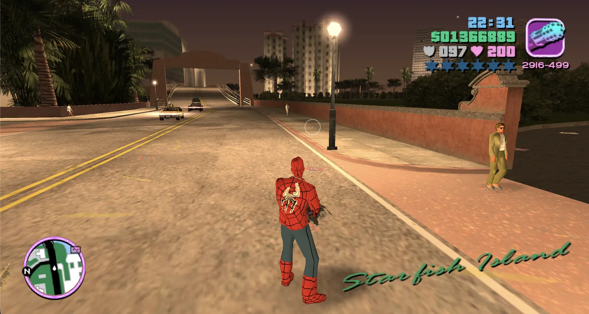

# GTA: Vice City — WASM Port

Play GTA: Vice City right in your browser. Nothing to install: the game runs on your own device and keeps working offline.

[](https://joncodeofficial.github.io/gta-vice-city-wasm/)



You need GTA: Vice City for PC installed on your computer — see [How it works](#how-it-works). Game files are not provided here.

## What's included

- **Play in your browser.** Nothing to install, and your game files stay on your device.
- **Your own saved games.** Import, export and remove PC saves.
- **Custom skins.** Change how Tommy looks with your own images.
- **Cheats on demand.** Off by default; switch them on from the setup screen.
- **Touch controls.** On-screen controls for phones and tablets.
- **Controller support.** Pair a controller and press any button to play.
- **Install it as an app.** Add it to your desktop or home screen from the browser.

## How it works

1. Install GTA: Vice City for PC from your own copy (Steam, Rockstar Games Launcher or the original discs)
2. Open the [live page](https://joncodeofficial.github.io/gta-vice-city-wasm/) and drop the folder where the game is installed onto **Game files (PC)**, or click it to choose the folder. On a phone, choose a `.zip` of that folder
3. The game loads into your browser's local storage (OPFS). It takes a few minutes and only happens once. Nothing is uploaded
4. Click **Start to play** and the game loads entirely from your device

Your imported data persists between sessions so you only need to import once unless you clear browser storage.

The site only hosts the engine (`public/engine/`) and a few files from the reVC project (`public/revc/`), such as controller button icons and `revc.ini`. Everything from the game comes from your own install.

## Saves & skins

Before pressing Start, you can add your own saved games and character skins from the **Saves & skins** section.

### Saves

- Add a saved game downloaded for **GTA Vice City on PC**. Files named `GTAVCsf1.b` to `GTAVCsf8.b`, or a `.zip` containing one, both work.
- Importing into a slot that already has a save replaces it.
- You can download your saves to keep them safe.

### Skins

- Add a skin as a `.bmp`, `.png`, `.jpg` or `.zip` file. It is adjusted automatically.
- Once in game, open *Options → Player Skin Setup*, pick your skin and leave the menu to put it on.
- Skins only change Tommy's everyday outfit.

If your download is a `.rar` or `.7z`, unpack it first. *Reset game data* also deletes your saves and skins.

## Requirements

- A modern desktop browser with WebAssembly + OPFS + Service Worker support
- Recommended: Chrome 110+, Firefox 111+, or Safari 16.4+
- GTA: Vice City for PC installed (about 1.5 GB), and about 1.2 GB of free browser storage for the converted game

## Running locally

```bash
pnpm install
pnpm dev
```

Then open `http://localhost:5173`.

To test the conversion outside the browser, run it on an install folder:

```bash
node scripts/convert-pc.mjs "<path to GTA Vice City>" out/
```

## Tech stack

- **Vite** — dev server and build tool
- **WebAssembly** — game engine compiled from C++ via Emscripten
- **OPFS** (Origin Private File System) — stores the converted game data locally in the browser
- **Service Worker** — intercepts fetch requests to serve game files from OPFS
- **Web Worker** — converts the game install off the main thread (`src/convert/`, MP3 encoding with [lamejs](https://github.com/zhuker/lamejs))

## Credits

**Browser client port** (OPFS storage, Service Worker, import UI, GitHub Pages deploy):
[@joncodeofficial](https://github.com/joncodeofficial)

**Based on** [reVCDOS](https://github.com/Lolendor/reVCDOS) by [@Lolendor](https://github.com/Lolendor)

**WASM engine port** by the DOS Zone team:
- [@specialist003](https://github.com/okhmanyuk-ev)
- [@caiiiycuk](https://www.youtube.com/caiiiycuk)
- [@SerGen](https://t.me/ser_var)

The game engine is based on the open-source reverse engineering project [re3/reVC](https://github.com/SugaryHull/re3/tree/miami).

## License

This repository's source code is licensed under the [MIT License](LICENSE).

## Disclaimer

This is an unofficial, non-commercial fan project. It is not affiliated with, endorsed by, or sponsored by Rockstar Games or Take-Two Interactive. "Grand Theft Auto" and "Vice City" are trademarks of their respective owners and are used here only to describe which game this software is compatible with.

The source code in this repository does not include the game's data files (models, textures, audio, maps). It is built on an open-source reimplementation of the game engine, and you need your own legitimate copy of GTA: Vice City to use it. The maintainer does not authorize anyone to redistribute the game's files and is not responsible for how third parties obtain, host, or share them, nor for any consequences of unauthorized use of this project.

This software is provided "as is", without warranty of any kind. See the [LICENSE](LICENSE) file for the full liability disclaimer.

## Disclaimer

This is an unofficial fan project, not affiliated with or endorsed by Rockstar Games or Take-Two Interactive. *Grand Theft Auto* and *Vice City* are trademarks of Take-Two Interactive. This repository contains no game assets; you must own the game to play.
